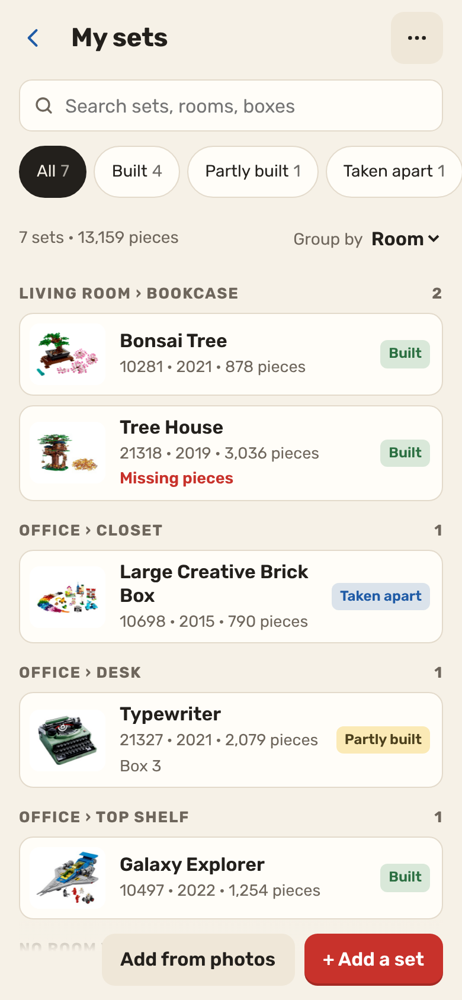
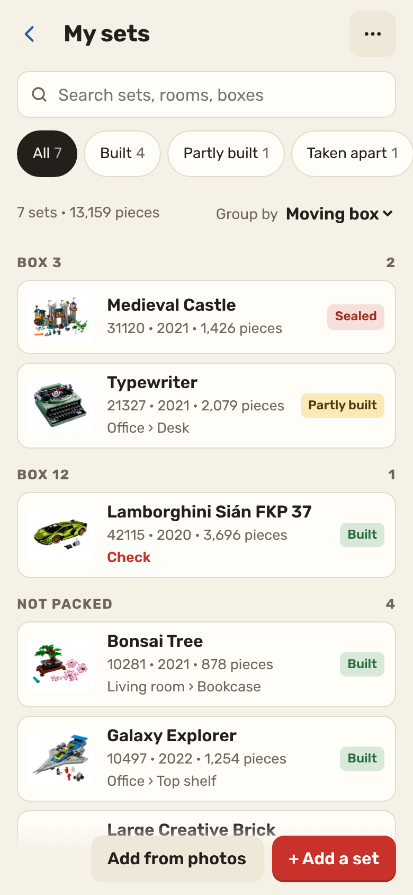
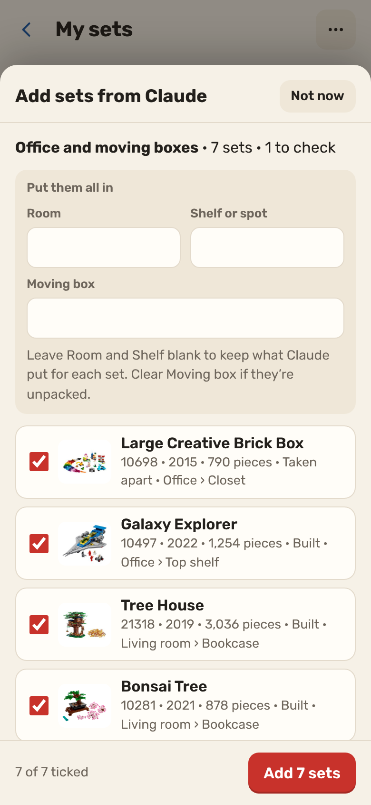
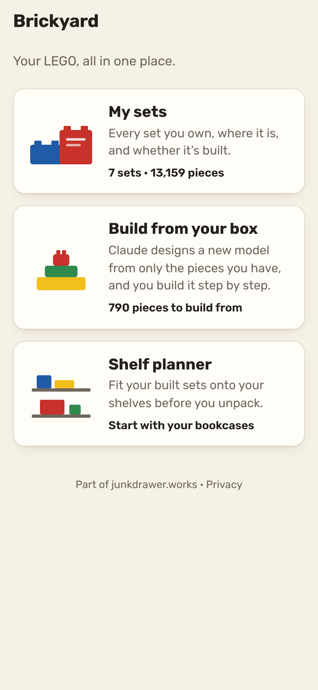
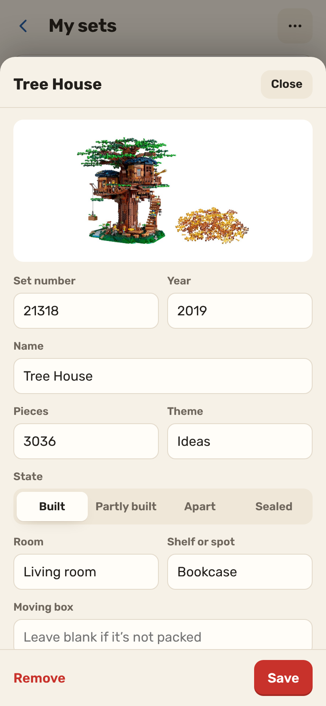
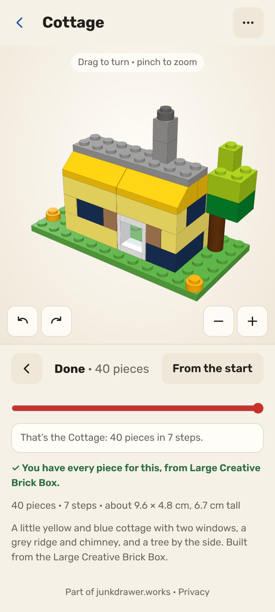
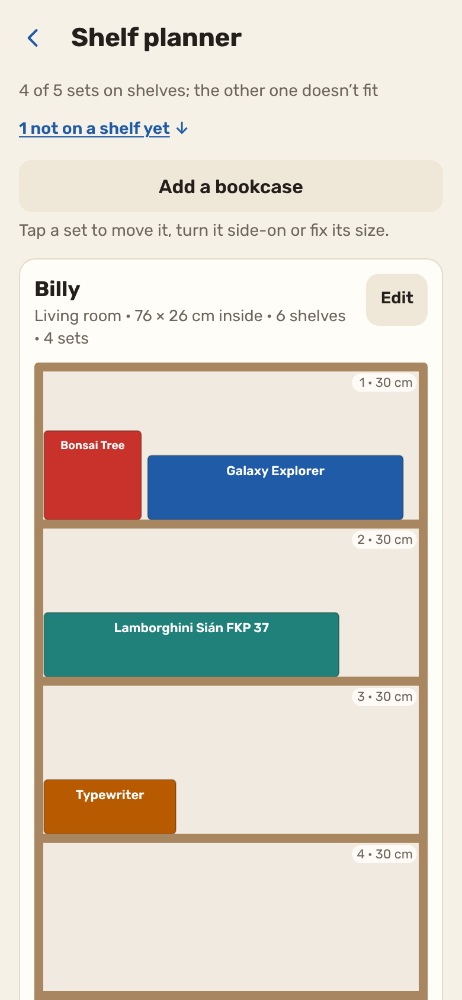

# Brickyard

**Use it: [brickyard.junkdrawer.works](https://brickyard.junkdrawer.works/)**

**A home for your LEGO: every set you own, where it is, and whether it's built.** Send Claude photos of your set boxes or built models, open the link it gives you, and the sets are in. While you're moving, it tracks which box each set is packed in.

<p align="center">
  
  &nbsp;
  
  &nbsp;
  
</p>

Brickyard is one app with three parts, all reading from the same catalog: **My sets**; **Build from your box**, where Claude designs a new model from only the pieces you own, Brickyard checks you can really build it, and shows it in 3D step by step; and the **Shelf planner**, which fits your built sets onto your bookcases.

<p align="center">
  
  &nbsp;
  
</p>

## How it works

- **A catalog of sets.** For each set it keeps the number, name, year, piece count and theme; where it is (a room and shelf, or a moving box); whether it's built, partly built, taken apart or sealed; missing pieces; whether you have the paper instructions; its built size, for the shelf planner; tags and notes.
- **Add from photos.** Claude reads the set numbers off boxes and instruction books, or recognises built models, and makes a Brickyard link. **Copy a note for Claude** copies the request to send with the photos: it names Brickyard, says where the format is for a Claude without the cataloger skill, and ends "They are in: " for you to finish. Opening it shows the list first: sets you already own are unticked, a set you own that the link has somewhere else (another room, shelf or moving box, or in another state) is offered as a move ("Move it: Box 7 (now Living room › Bookcase)", ticked, changing only those on the set you have; **Add a second copy instead** is under it, and a set you own twice is left alone), a set you typed in by name gets its number filled in, a set that's in the list twice says so, anything Claude wasn't sure of is marked **Check**, and you can put the whole batch in one room, shelf or moving box before tapping **Add**. A link that arrives cut short, or with a wrong character, says so, and to copy the whole link again or open the file that came with it. On an iPhone or iPad, Brickyard on the home screen keeps its own sets, apart from the browser's, and a tapped link opens in the browser: opened from the home screen, **Add from photos** puts the paste box first with a **Paste** button and says to copy the link and paste it, and in the browser with no sets yet the review says so and copies the link to take across.
- **Find things.** The search box stays in view under the title while the list scrolls. Coming back to My sets from another screen returns to where the list was. A tap on a group's heading (a room, a theme, a day) folds its sets away under it, and **Fold all** beside the count folds every group, so a long list is a screen of headings; by moving box the heading opens the box, and the arrow before it folds. What's folded is remembered on each device (in `brickyard.prefs`, with the other settings; it doesn't sync), a search or a filter shows every set it finds, and a printed list has them all. Search covers names, numbers, themes, places, tags, notes and what's missing or to check, and "box 3" (or "what's in box 3") finds what's packed in box 3, loose pieces too; when no box has that label the words are searched as usual, so "brick box 10698" finds the Brick Box. A plural finds the singular, and "not packed", "missing pieces" and "to check" find what they say. Filter by state, missing pieces or to check (and, while anything is in a moving box, by **Not packed**: what's left to pack; while a set is in the catalog more than once, by **Doubles**), and, with **Sort and group**, group by room, moving box, theme or state, or sort newest first, under the day each set was added, with the day on each row. A row says what's missing and what to check. Under the Missing pieces filter, **Copy this list** copies what's missing from the sets shown, a line a set ("60337 Express Passenger Train: one dark grey 1x2 plate"), for an order of replacement pieces. **Print this list** in the menu prints what My sets is showing: search for a box first and it's that box's packing list.
- **Moving boxes.** Group by moving box and each box's heading opens the box: its sets and loose pieces, with **Unpack this box** (everything in it as a ticked list, with one room and shelf for all the sets you tick, or blank to leave each where it says), **Add sets to this box** (tick the ones you're packing), **Copy this list** (for a label or a message) and **Rename this box**. A search for a box has a button for the same. Saving a set into or out of a box says how many the box holds now, or that it's empty; unpacking says how many boxes are still packed, and when every box is unpacked.
- **Pictures** of each set come from [Rebrickable](https://rebrickable.com/) by set number. Turn them off in the menu and nothing leaves your browser.
- **Instructions at LEGO.** A set with a number has a link in its sheet to LEGO's own page of building instructions for that number (`lego.com/service/buildinginstructions/NUMBER`), which opens in a new tab. Nothing is sent to LEGO unless you tap it, and then only the set's number, in the address.
- **Backups.** Download the whole catalog as a file and open it on another device (it merges), or download a spreadsheet (CSV). The file holds your models from Claude too, and opening it adds the ones that device doesn't have. Opening a backup can also bring back sets removed since it was saved. Merging keeps the later change to each set, so it can't undo a mistake made since the file was saved; for that, a backup file has a second choice, **Put everything back the way this file has it**: the sheet counts what will change ("12 sets go back to how they were; 3 added since are removed"), the button takes a second tap, and the message afterwards has Undo. What it puts back wins on every device that syncs. The menu says when the last backup was downloaded in this browser, and while Drive sync is off the home screen has one quiet line when a backup is due: something has changed since the last one, and it was 30 days ago or more, or 20 things have changed. Tapping it downloads one. Brickyard also asks the browser to keep its storage (`navigator.storage.persist()`), since a browser may clear a site's storage by itself; in Firefox, which asks you first, only when you download a backup.
- **Recently removed.** Removing a set has Undo for ten seconds; after that, **Recently removed** in the menu lists the sets removed on this device in the last 30 days, each with **Put back**. The list is kept on that device only, beside the catalog (`brickyard.removed` in localStorage): it isn't in a backup and doesn't sync, so only the device that removed a set can put it back.
- No account and no server. Your catalog stays in your browser unless you turn on Google Drive sync (below). It works offline and installs to a phone's home screen.

## Adding sets with Claude

`skill/brickyard-cataloger/` is a skill for Claude. Send it photos of your sets and it identifies each one, checks the set numbers, and hands them to Brickyard as a link and a `.brickyard.json` file. Its script also runs on its own:

```sh
python3 skill/brickyard-cataloger/scripts/make_brickyard.py sets.json
```

`skill/brickyard-cataloger/references/brickyard-format.md` describes the link, batch and backup formats.

## Build from your box

<p align="center"></p>

- **Your pieces** are the parts lists of the sets in My sets that are taken apart (tick or untick each one), plus any **loose pieces** you've added (below). Brickyard has a parts list for the Large Creative Brick Box (10698) so far; `parts/sets/` holds one file per set and `parts/index.json` lists them, so adding a set is adding its list there. A taken-apart set without a list is named under Your pieces, and **Copy my taken-apart sets** copies those sets as a request to paste into a Claude session opened on this project, which adds each list (a chat can't: a list is a file here).
- **Copy my pieces for Claude** copies the whole pool as `part/colour ×count`. Paste it to Claude with what you'd like built. Its last line says where a model's rules are, for a Claude without the designer skill.
- **I've built this**, in a model's menu, marks the model as built. While it is, its pieces are out of your pieces for every other model's check and for Copy my pieces for Claude (whose first line then ends "less the pieces in Cottage, which is built"), and its row says Built. **I've taken this apart** gives them back. Kept in this browser with the model.
- **Models** from Claude open from a link (`#d2z…`) or a pasted file, and stay in this browser. Each one is checked against your pieces: enough of every part in every colour, nothing overlapping, everything joined by studs, every step joining onto what's built, and no piece that would have to be squeezed in between pieces already built. A model you haven't started opens on its finished picture, with its pieces and steps and **Start building**; one you have started opens on the step you left (kept for the tab). A 3D view (three.js, in `js/vendor/`) shows each step with the pieces to find. While a step is showing, the pieces it adds have a crisp outline and the ones built before are faded a little, so what's new can be seen at a glance; the finished model is at full colour, and finishing with **Next** turns it round once (a touch stops it; not when the device asks for less motion). The picture fits the whole model on a phone; at a step it is framed on what's built so far and moves out as the model grows (never nearer than a third of the way in), until you turn or zoom it yourself, and **Reset view** puts it back. Four buttons in the picture's bottom corners turn it left and right and zoom out and in, a tap each, and with the keyboard on the picture the arrow keys turn it and + and - zoom. Under a step's pieces, **Where they go** says in words where each one goes: how high, what it sits on, how many studs in from the model's front left corner, and which way it's turned ("Brick 1x4, Bright Light Yellow: 1 plate up, on the bright green 6x12 plate, 2 studs in from the left, 1 stud back from the front, running left to right"). It's folded away, and open where the browser can't show 3D. A model that can't be built says which piece is wrong, by colour, name and step. Opening a model you already have (the same parts, in any order) updates it in place, so a corrected name or description from Claude shows, and each row says when the model was added. **Copy a link to this model**, in a model's menu, copies it as the same kind of link (`#d2z…`), to open on your other device or send to someone: models stay on each device. **Rename** there gives a model your own name, which it keeps when Claude's link to the same model is opened again.
- **Loose pieces** are bricks that aren't a set: a tub, a bag, a moving box. A lot of them arrives as a link (`#l1z…`, or `#l2z…` with a check on its end) or a `.brickyard-loose.json` file, from Stud Finder (a tray scanner that counts and names loose parts) or from anything else that can write the format. Opening one shows what's in it and how much of it the builder can use today, and adds it to Your pieces, where it can be unticked or removed; a tap on its name there renames it or changes its moving box. Each lot keeps its id, so opening a recount replaces the lot instead of doubling it. A lot's link can be pasted into **Open a model** (every paste box takes any Brickyard link or file and sends it to its own review). Parts the builder can't draw yet are kept and start counting when their shapes are added to `parts/shapes.json`. A piece counted under its everyday number (3023, where the builder has 3023b) counts as that piece; `parts/aliases.json` lists those numbers.
- `skill/brickyard-designer/` is the skill Claude designs with. Its script does the same checks as the page and makes the link:

```sh
python3 skill/brickyard-designer/scripts/check_model.py model.json --layers
```

The skill has to work on its own once it's uploaded to Claude, so it carries a copy of `parts/` in `skill/brickyard-designer/data/`. After any change to `parts/`, run `node tools/copy-skill-data.mjs` (the tests fail while the two differ) and upload the skill again.

## Shelf planner

<p align="center"></p>

- **Bookcases**: add each one with its inside width and depth and the clear height of each shelf, top shelf first, a box for each (presets for an IKEA Billy, a narrow Billy and a Kallax column; a Billy's shelves move, so its preset is six even spaces of about 30 cm to measure against yours). Each is drawn from the front, to scale, with your sets on it. With **Show set pictures** on, a set with a number is drawn as its picture with its name on a strip below; the others, and any whose picture doesn't arrive, are blocks coloured by theme. On a screen wider than a phone they are all drawn at one scale and stand in a row, like furniture along a wall. Sizes are in cm; one typed with `in` or `"` after it is worked out and the message says so.
- **Fit the sets onto the shelves** places every built or partly built set that isn't on a shelf yet. It tries eight ways of taking them, tallest first to begin with, and keeps the one that gets most sets onto shelves. Each set goes on the shortest shelf that takes it with 1 cm clear above it, facing out, or side-on when no shelf of that height takes it facing out. A set with a room in My sets goes on a bookcase in that room when one takes it, and wherever it fits when none does. Shelves that suit a set equally are filled from eye level (about 1.4 m up) outwards, so the lowest shelves fill last. Tick **Keep themes together** under the button and a set goes beside one of its own theme first, then on an empty shelf, which can spread the sets over more shelves; the tick is remembered on that device. By hand a set can still stand on a shelf exactly its height. Sets already placed stay put, and the message has Undo. Anything that doesn't fit says why (too tall, no room above it, too deep, too wide, no room left), and one line adds the reasons up, with about how much more shelf the sets short of room would take. **Take every set off** in a bookcase's sheet starts it again. Under the count at the top, **not on a shelf yet** and **need a size** go to those two lists, which can be a long way down the page.
- Tap a set to move it to another shelf, turn it side-on, move it left or right, or fix its size. Move left and Move right keep the set's sheet open, to tap more than once. By hand a set can go on a full shelf too: the list of shelves says how far over each would be, and the shelf is then flagged overfull until a set comes off. Shelves too short, too shallow or too narrow for the set are greyed out, and Fit never overfills. A line over a bookcase says what's wrong on it: a shelf that's overfull, a set too tall or too deep, a set that has been taken apart or sealed since it was placed (with a button to take it off).
- **Put these places in My sets** copies each placed set's room and shelf into the catalog, with Undo; the card counts the sets it would change first.
- **Sizes**: the planner needs each set's built width, depth and height. **Copy these for Claude** copies the sets without one that have a set number (a size comes back by its set's number; the screen says how many others there are to measure), with which way round width and depth go and a plain form to answer in for a Claude without the cataloger skill; it answers with a sizes link (`#z2z…`) that fills them in after you review them. A size that looks wrong for its set (3 cm tall for 4,514 pieces) arrives unticked with the reason.
- Bookcases are saved with the catalog, so backups and merges carry them. Where each set stands is saved set by set, with the time it was put there: two devices that each change the same bookcase before they sync both keep their changes, a set stays where it was last put, and one taken off stays off.

## Sync with Google Drive

Your catalog is saved in each browser on its own. To have the same sets on your laptop and phone, tap **Sync across your devices with Google Drive** (or the cloud button) on each one and sign in with the same Google account.

- **What syncs:** My sets, your bookcases (and where each set stands on them) and your loose pieces, as one file, `Brickyard catalog.json`, in a **Brickyard** folder in your Drive. Changes on each device are merged set by set; when the same set is changed on two devices, the later change wins, and a set removed on one is removed on all. A set added on two devices before they first synced would be there twice: on a device's first sync (and when a backup or a catalog link is opened) a copy with the same set number and the same details is kept once, and a message says how many. Copies that differ in anything are left alone, since you may own two; the **Doubles** filter in My sets lists them.
- **What you see:** the sync button is on every screen (on a phone, beside Build from your box, it's its dot alone). When a sync brings in changes from another device, one line says what: "From your other devices: 3 sets added", or "1 set changed, Bonsai Tree removed". Nothing is said for the device's own changes.
- **What stays on each device:** models from Claude (a downloaded backup carries them; the file in Drive doesn't), which sets and lots are ticked as your pieces, the Recently removed list, and settings such as pictures on or off.
- **Permission:** only `drive.file`, so Brickyard sees the files it made and nothing else in your Drive. It shares one Google sign-in with the other [junkdrawer.works](https://junkdrawer.works/privacy.html) projects.
- **Stop syncing on this device** in the sync sheet stops this device and leaves the file in Drive. To remove access entirely, remove junkdrawer.works at [myaccount.google.com/connections](https://myaccount.google.com/connections), and delete the Brickyard folder if you like.
- Sync works only at brickyard.junkdrawer.works. In a copy somewhere else (such as one opened inside Claude), **Copy everything as a link** in the menu makes a link that carries the whole catalog to Brickyard, where opening it merges it in.

## Running it

It's a static site: plain HTML, CSS and JavaScript, with no build step.

```sh
npx serve .                   # or any static file server, then open the printed address
npm test                      # unit tests, then uses it in Chromium through the real page (needs Playwright)
node tools/screenshots.mjs    # redraws docs/*.png and og.png (fetches the sample sets' pictures into tools/pics once; PICS=none for plain bricks)
node tools/make-icons.mjs     # redraws the PNG icons from icon.svg
node tools/copy-skill-data.mjs  # copies parts/ into the designer skill's data/, after parts/ changes
node tools/build-artifact.mjs # packs the whole app into one file, dist/artifact.html, for a copy opened inside Claude
```

To put it online with GitHub Pages: **Settings → Pages → Build and deployment → Deploy from a branch**, then pick `main` and `/ (root)`. The `CNAME` file serves it at brickyard.junkdrawer.works.

### Files

- `index.html`: the home screen, the catalog, the builder and the shelf planner.
- `js/core.js`: cleaning sets and lots of loose pieces, merging catalogs, finding doubles, search, moving boxes (what one holds, how the packing stands), links and the spreadsheet. No DOM, so the tests run it in Node.
- `js/app.js`: the screens, sheets and storage (`brickyard.v1` in localStorage).
- `js/sync.js`: Google Drive sync.
- `js/build-core.js`: the builder's checks and model links, no DOM; `js/build.js`: the builder's screens and 3D view.
- `js/vendor/`: three.js and its OrbitControls (MIT, `LICENSE.three`), kept here so nothing loads from elsewhere.
- `js/shelf-core.js`: the shelf planner's fitting and sizes links, no DOM; `js/shelves.js`: its screen and drawings.
- `parts/`: part shapes on the stud grid, LDraw colours, other numbers for the same piece (`aliases.json`: 3023 is the 1x2 plate the builder knows as 3023b), and each set's parts list (copied into `skill/brickyard-designer/data/`). `models/`: the example cottage.
- `css/app.css`: light and dark palettes.
- `skill/brickyard-cataloger/`, `skill/brickyard-designer/`: the Claude skills and their scripts.
- `test/core.test.cjs`, `test/build.test.cjs`, `test/shelf.test.cjs`, `test/e2e.mjs`, `test/backup.mjs`, `test/sync.mjs`: the tests. `test/backup.mjs` is the browser test for doubles and what keeps a catalog safe. `test/sync.mjs` runs Drive sync against `test/fake-google.mjs`, a stand-in for Google's sign-in and Drive. `test/fixtures/sample.json` is the sample batch the tests and screenshots use.
- `tools/`: the scripts under Running it: `screenshots.mjs`, `make-icons.mjs` (from `icon.svg` and `icon-full-bleed.svg`), `copy-skill-data.mjs` and `build-artifact.mjs`.
- `fonts/`: Rubik (SIL Open Font License, `fonts/OFL.txt`), served from here so nothing loads from elsewhere.
- `sw.js`: keeps a copy for using offline, and opens from it when the connection isn't answering. `FILES` in it is a fingerprint of the files it keeps: change one and `npm test` says what to set it to, so a release never leaves the copy half old.

## License

MIT — see [LICENSE](LICENSE).
